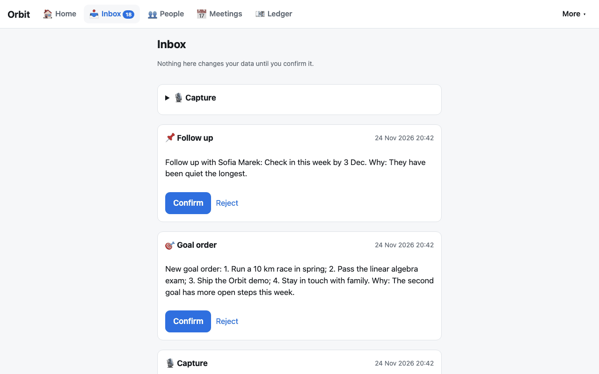
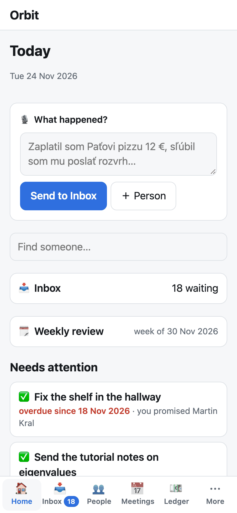
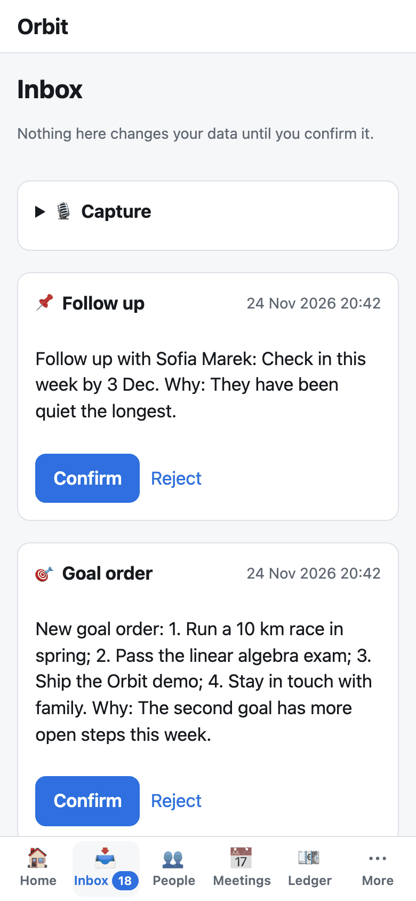
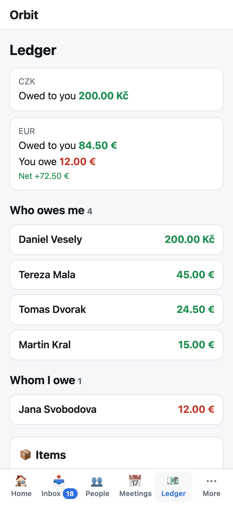
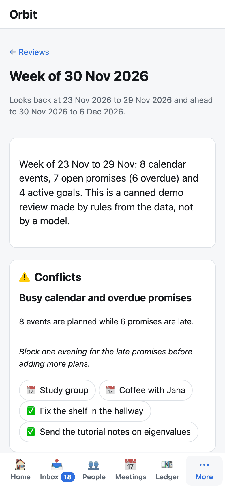
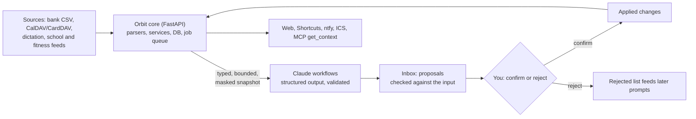

# Orbit

A self-hosted personal operating system where Claude proposes and you confirm. It keeps people, money owed between
friends, promises, goals, meetings, bank rows, workouts and sleep in one place, turns messy input (a dictated note,
a bank CSV) into structured proposals, and never changes your data until you tap Confirm.



<p>
  
  
  
  
</p>

All screenshots come from the offline demo instance (a fictional persona, no real data).
More in [`docs/images/`](docs/images/).

**Claude workflows here are structured-output workflows with a human approval gate, not autonomous tool-using agent loops.**
The model never calls tools against Orbit and never writes to the database. It returns a typed answer; Orbit
validates it, stores it as a proposal, and a person decides.

Status: a solo project built in Sept-Oct 2026, with an AI-engineering pass (evals, tracing, cost, injection hardening)
added in Nov 2026. See [Status and limits](#status-and-limits).

## Why it exists

Keeping track of who owes whom, what I promised, and who I have not talked to for a while was spread over a notes
app, a bank app and my memory. Orbit puts it in one database with one shared context, and lets a language model do the
tedious parts (reading a dictation, labelling bank rows, drafting a weekly review) without giving it the keys.

## How it works

**Propose and confirm.** Every Claude-driven feature ends in a `Proposal` in the Inbox. Confirm applies it through
normal service code; Reject teaches later prompts what you do not want. There is no auto-settle of debts, ever
([`docs/DECISIONS.md`](docs/DECISIONS.md) #2).

**Autonomy ladder.** The system is built around five levels ([`docs/VISION.md`](docs/VISION.md) section 3):

| Level | Name | Behaviour |
|---|---|---|
| L0 | Observe | Reads and stores data |
| L1 | Inform | Briefs, digests, the weekly review; changes nothing |
| **L2** | **Propose** | Writes a proposal; nothing changes until confirmed. **The default and, today, the ceiling** |
| L3 | Act with undo | Not used; would need its own decision record |
| L4 | Act | Not used |



The same picture as a standalone file: [`docs/images/architecture.svg`](docs/images/architecture.svg). Details in
[`docs/ARCHITECTURE.md`](docs/ARCHITECTURE.md).

## Modules

| Module | What it does |
|---|---|
| People | People, aliases, handles, tags with contact cadences, notes, interactions, duplicate merge with undo |
| Ledger | Money, item and favor debts in both directions, settle proposals, payment matching |
| Bank import | Tatra and Revolut CSV parsers, idempotent by row hash, Claude labels rows, split flagging |
| Calendar and contacts | CalDAV and CardDAV sync (two-way contacts with undo), pre-meeting briefs, post-meeting capture |
| Capture | Dictation to debts, promises, settles, appointments and deadlines, as proposals |
| Goals and review | Goals, promises, a weekly review with its input stored so claims can be checked |
| School | Course pages, ReCodEx and OWL feeds, deadlines (parsers follow a Czech university's formats) |
| Fitness and health | Liftoff workouts and an Apple Health sleep payload, as context for the review |
| Ops | Claude page with queue, worker, usage, cost and budget; scheduler jobs; encrypted backups |

## Interfaces

- **Web**: mobile-first Jinja and HTMX UI, password login (argon2).
- **iOS Shortcuts**: dictation, health export, quick actions ([`docs/SHORTCUTS.md`](docs/SHORTCUTS.md)).
- **ntfy**: push notifications with quiet hours, retries and dedupe keys.
- **ICS feed**: calendar subscription with meetings, birthdays and name days.
- **MCP**: one read-only tool, `get_context`, so Claude Code can read the shared context ([`docs/MCP.md`](docs/MCP.md)).

## AI engineering

### Structured outputs
Each workflow asks for a Pydantic-typed answer. A validation error is sent back to the model once. The result is then
checked against what the model was shown: unknown person or debt ids, invalid amounts and forbidden proposal kinds are
dropped. Amounts are integer minor units. Every feature also has a no-model fallback (for example a note draft).

### Evals
`evals/` holds 152 hand-written synthetic cases (capture 56, classify 51, review 45) and 30 deterministic graders, plus
45 deliberately wrong answers, each of which a grader must catch ([`docs/EVALS.md`](docs/EVALS.md)).

| Suite | Cases | Recorded mode | FakeClaude (offline) |
|---|---|---|---|
| capture | 56 | 56/56 | 16/56 (28.6%) |
| classify | 51 | 51/51 | 41/51 (80.4%) |
| review | 45 | 45/45 | 23/45 (51.1%) |

Read this carefully: **recorded mode replays hand-written answers, so 100% shows that the graders, case files and
pipeline are consistent. It is not a measured pass rate of any model.** No live pass rate has been measured yet. A
live run (`--mode live --k 3 --max-eur 2`, manual workflow `evals-live.yml`) is implemented and tested with stub
clients but has not been run against the real API. The optional LLM judge for review summaries is not trusted yet:
its offline heuristic baseline agrees with my labels on 15 of 20 samples (kappa 0.48, below the 0.85 / 0.6 bar).
Cases and labels were written by one author.

### Observability and cost
Each model request produces an OpenTelemetry GenAI span (`gen_ai.usage.*`, model, purpose, prompt version, latency,
cost, no prompt text); export with `ORBIT_OTEL_EXPORTER=console|otlp`
([`docs/OBSERVABILITY.md`](docs/OBSERVABILITY.md)). Every call is stored with an estimated cost in EUR. With
`CLAUDE_MONTHLY_BUDGET_EUR` set, a push goes out at 80% and API calls stop at 100% (features fall back to their
no-model modes). The built-in prices and the USD-EUR rate are estimates and need checking against current price pages
before you rely on them; override with `CLAUDE_PRICE_OVERRIDES`. Cache tokens are not tracked yet.

### Prompt versioning
Eight prompts carry a version (`capture@1`, ...) stored on every call and proposal. A test hashes the prompts and
fails if one changes without a version bump and a changelog line ([`docs/PROMPTS.md`](docs/PROMPTS.md)).

### Security
Full analysis: [`docs/threat-model.md`](docs/threat-model.md); reporting: [`SECURITY.md`](SECURITY.md).
- **Indirect prompt injection**: all outside text (bank rows, calendar titles, contact notes, course pages, dictation)
  is wrapped in `<untrusted_data>` tags with tag-escaping, and every system prompt states that tagged text is data.
  83 test cases use 14 hostile payloads; because the offline stand-in is rule-based, they prove wrapping and output
  guards, not model robustness.
- **Approval gate as the real control**: the model cannot write; output guards check ids and kinds.
- **Worker without tools**: the server worker runs `claude -p` with all tools disabled, in an empty directory.
- **MCP**: a dedicated `ORBIT_MCP_TOKEN` accepted only on `GET /api/v1/context` (a test walks every route), validated
  inputs, a static single tool over stdio, and an append-only JSONL audit log.
- **Masking**: IBANs and phone numbers are masked in prompts.
- **Lethal trifecta stance**: on the server the model sees private data and untrusted text but has no tools and no
  outbound channel, which removes the third leg. A desktop Claude Code session that combines the MCP tool with
  other tools does not have that guarantee; this is documented, not solved.
- **Residual risks** (listed in the threat model): no ceiling on debt amounts in capture, desktop MCP output is not
  tag-wrapped, a poisoned note can still skew a proposal that a tired owner confirms, the audit log is not tamper-proof.

## Quick start with demo data

No account, key or network needed. Claude is replaced by FakeClaude, a rule-based stand-in. Requires
[uv](https://docs.astral.sh/uv/).

```bash
uv sync
```

The app refuses to start without secrets, so set throwaway ones for the demo (this block is verified; the password
is `demo-password`), migrate, seed and start the server in the same shell:

```bash
tok() { uv run python -c "import secrets; print(secrets.token_urlsafe(32))"; }
export ORBIT_API_TOKEN="$(tok)" ORBIT_SECRET_KEY="$(tok)" ICS_TOKEN="$(tok)"
export ORBIT_WEB_PASSWORD_HASH="$(uv run python -c "from orbit.services.passwords import hash_password; print(hash_password('demo-password'))")"
export ORBIT_URL=http://127.0.0.1:8000 ORBIT_CLAUDE_MODE=fake OWNER_NAME=Alex SCHEDULER_ENABLED=false
uv run alembic upgrade head
uv run python -m orbit.cli seed-demo
uv run uvicorn orbit.main:app --port 8000
```

Open http://127.0.0.1:8000 and sign in. `scripts/demo_smoke.sh` does all of this unattended and checks `/healthz` and
`/api/v1/context`.

## Real setup

```bash
cp .env.example .env
```
1. `ORBIT_API_TOKEN`, `ORBIT_SECRET_KEY`, `ICS_TOKEN`: at least 32 random characters each, from
   `uv run python -c "import secrets; print(secrets.token_urlsafe(32))"`.
2. Run `uv run python -m orbit.cli hash-password`. It prints a complete line that starts with
   `ORBIT_WEB_PASSWORD_HASH=`. **Replace the whole `ORBIT_WEB_PASSWORD_HASH=` line in `.env` with that printed line**
   (do not paste the hash after the existing `=`; keep the single quotes).
3. `ORBIT_URL=http://localhost:8000` for local use (an `https://` URL marks the session cookie Secure).
4. Claude is optional. Without a key or worker, captures stay as note drafts. Options: `ANTHROPIC_API_KEY` and
   `ANTHROPIC_MODEL`, or a Claude Code worker on the server ([`docs/DEPLOY.md`](docs/DEPLOY.md) step 10).
5. Optional: `NTFY_TOPIC` for pushes (`uv run python -m orbit.cli test-push`), `CLAUDE_MONTHLY_BUDGET_EUR`.

Keep comments in `.env` on their own lines: `KEY=   # comment` makes the comment the value.

```bash
uv run alembic upgrade head
uv run fastapi dev orbit/main.py      # http://localhost:8000
```

**Docker**: `docker compose up -d --build` runs the app on SQLite; `docker-compose.prod.yml` adds HTTPS, Postgres and
encrypted backups ([`docs/DEPLOY.md`](docs/DEPLOY.md)).

## Testing

```bash
uv run pytest -q                                   # 2192 passed in about 3.5 minutes (206 s) on a laptop (SQLite)
uv run ruff check && uv run ruff format --check    # clean (all test files)
uv run mypy                                        # clean (175 files); strict on domain and services
shellcheck scripts/*.sh                            # clean
uv run python -m evals.run --mode recorded         # 56/56, 51/51, 45/45
```
125 test files and about 1,500 test functions; roughly 31k lines of application code and 22k lines of tests
(non-blank Python lines). CI (`.github/workflows/ci.yml`) runs ruff, mypy, pytest, the recorded evals, a Postgres
run, shellcheck and a backup-and-restore drill in Docker. I ran the SQLite suite locally; the Postgres job has not been re-run since the latest
changes.

## Status and limits

- Solo project, built Sept-Oct 2026; the evals, tracing, cost and hardening work is from Nov 2026.
- **Verification on a real deployed server with a real phone is still open** (unticked boxes in
  [`docs/ROADMAP.md`](docs/ROADMAP.md)). Earlier "worked live" notes were single development tries.
- Anthropic only. Single user. No RAG; context comes from typed providers.
- Cost figures are estimates from built-in prices; no live eval numbers yet.
- FakeClaude is rule-based and cannot be injected or reason; the demo shows the product flow, not model quality.
- The school module follows one university's page formats; Slovak and Czech name days and phone rules are built in.

## Tech

Python 3.12, FastAPI, SQLAlchemy 2, Alembic, Pydantic, Jinja2 and HTMX, SQLite or Postgres, APScheduler, argon2,
the Anthropic SDK or Claude Code, OpenTelemetry, caldav and icalendar, pytest, ruff, mypy, uv, Docker, GitHub Actions, age and rclone for backups.

## Repository layout

```
orbit/        app: api, web, domain, services (incl. context providers), integrations, jobs, mcp_server.py, tracing.py
evals/        cases, cassettes, graders, runner, judge calibration
tests/        pytest suite and synthetic fixtures
migrations/   Alembic (single head)
docs/         SPEC, VISION, DECISIONS, ARCHITECTURE, DEPLOY, MCP, OBSERVABILITY, PROMPTS, EVALS, threat-model, images/
scripts/      backup drill, restore, demo smoke test, Claude worker, screenshots, doc/codemap/scan checks
.claude/      agent permissions, hooks, skills, subagents, slash commands (docs/AGENT_SETUP.md)
Makefile      make help: fast, changed, gates, evals, demo, codemap, scan
deploy/ docker/   production compose files and configs
```

See also [`CONTRIBUTING.md`](CONTRIBUTING.md), [`CHANGELOG.md`](CHANGELOG.md) and [`AGENTS.md`](AGENTS.md) (working rules for coding assistants).
The repository is set up for AI coding agents (Claude Code, Codex, Cursor): shared instructions, a code map, permissions, hooks, skills, subagents and the
regression net are described in [`docs/AGENT_SETUP.md`](docs/AGENT_SETUP.md); [`docs/README.md`](docs/README.md) indexes all documentation; [`STATUS.md`](STATUS.md)
is the session memory (what is verified, what is open).

## License and credits

MIT, see [`LICENSE`](LICENSE). Built by Matúš Maruščák. <!-- scan:ok -->
