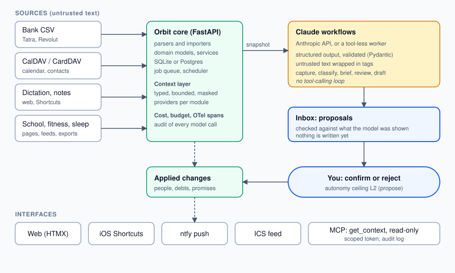

# Architecture

A short map. The long version is [SPEC.md](SPEC.md); the reasons behind choices are in
[DECISIONS.md](DECISIONS.md); the autonomy ladder is in [VISION.md](VISION.md) section 3.

## One request, end to end (dictation)

1. A note arrives from the web form, a Shortcut or the API and is stored as an intake item.
2. `services/capture.py` builds a request from a typed, bounded context snapshot (candidate people,
   their open debts and promises, goals, recent corrections). Outside text goes into
   `<untrusted_data>` tags and IBANs and phone numbers are masked.
3. The Claude client asks for a structured answer (Pydantic model). A validation error is fed back once.
4. The answer is checked against what the model was shown (known person ids, known debt ids, amounts as
   integers). Anything that does not match is dropped.
5. What survives becomes `Proposal` rows in the Inbox. Nothing else is written.
6. The owner confirms or rejects. Only then does the proposal's apply function change people, debts,
   promises or goals. Confirmed settles are never automatic.

## Layers

| Layer | Path | Rule |
|---|---|---|
| API and web | `orbit/api`, `orbit/web` | Thin: auth, parsing, rendering (Jinja and HTMX). |
| Services | `orbit/services` | Business logic; strict mypy. Providers under `services/context` build prompt snapshots. |
| Domain | `orbit/domain` | SQLAlchemy models and enums; strict mypy. |
| Integrations | `orbit/integrations` | Claude client, FakeClaude, bank parsers, CalDAV, CardDAV, ntfy, school sources, pricing. |
| Jobs | `orbit/jobs`, `orbit/services/claude_jobs.py` | APScheduler tasks; a database job queue for the Claude Code worker. |
| MCP | `orbit/mcp_server.py` | One read-only tool, `get_context`, over the HTTP API with a scoped token and an audit log. |

## Claude backends

`CLAUDE_BACKEND` and `ORBIT_CLAUDE_MODE` choose between the Anthropic API (key), a Claude Code worker on the
server (`claude -p` with no tools allowed, subscription), and the offline FakeClaude used by the demo and
the tests. With none of them every feature falls back to a plain mode (for example a note draft).

## Cross-cutting

- Idempotency: bank rows by hash with an occurrence counter; notifications by a dedupe key claimed before sending.
- Cost and tracing: [OBSERVABILITY.md](OBSERVABILITY.md). Prompt versions: [PROMPTS.md](PROMPTS.md).
- Evals: [EVALS.md](EVALS.md). Threat model: [threat-model.md](threat-model.md). MCP: [MCP.md](MCP.md).
