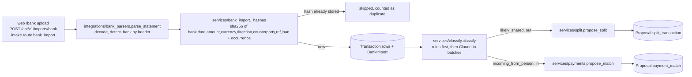
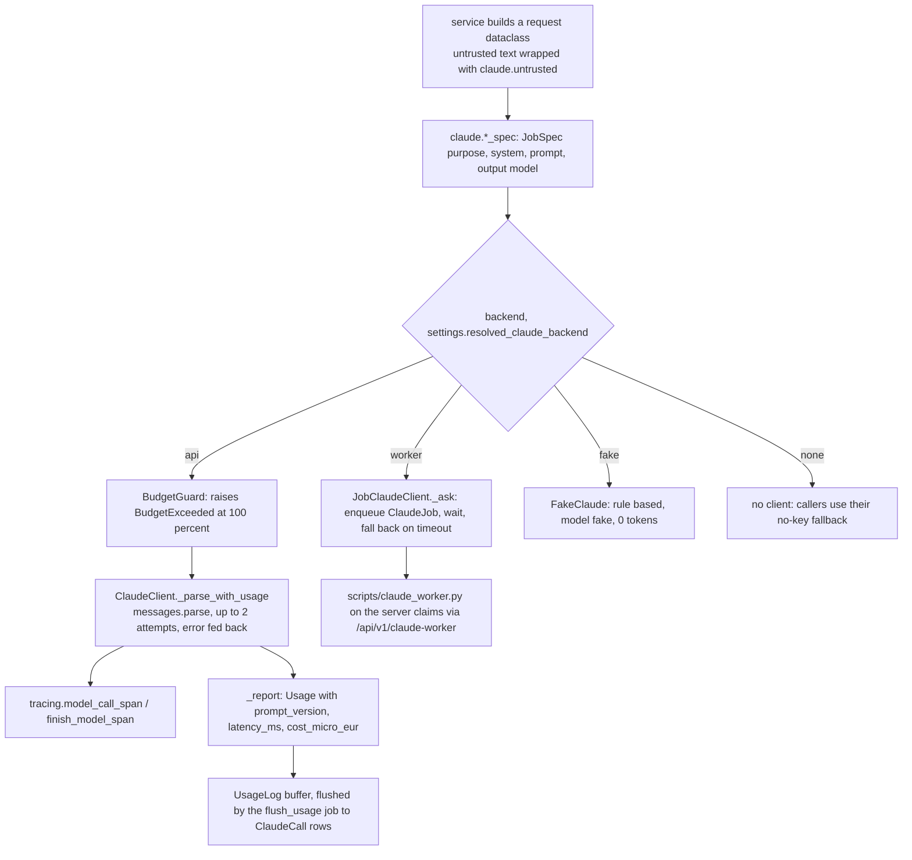
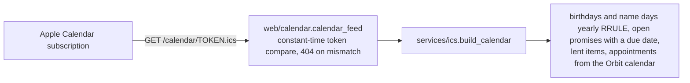
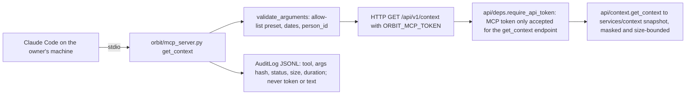

# Code map

Where things live and how data moves. Read this before searching the tree. The tables between
`GENERATED` markers are written by `scripts/gen_codemap.py` (`make codemap`); CI and pre-commit fail
when they are stale, so they match the code. The prose, diagrams and recipes are hand-written and
checked for dead paths by `scripts/check_docs.py`. Fully generated companions: every route with its
handler and auth in [ROUTES.md](ROUTES.md), every setting and CLI command in [CONFIG.md](CONFIG.md),
what each test imports in [TESTMAP.md](TESTMAP.md). Why things are the way they are: [ARCHITECTURE.md](ARCHITECTURE.md),
[DECISIONS.md](DECISIONS.md).

## 1. Layers and the one-way dependency rule

```
web/ + api/        thin: auth, parse input, call a service, render or return JSON
   |
services/          business logic; strict mypy; no FastAPI imports; "callers commit"
   |        \
domain/     integrations/   SQLAlchemy models + enums  |  Claude, ntfy, CalDAV, bank parsers, school sources
```

`orbit/app.py::create_app` builds every client once (Claude per backend, ntfy, calendar, school
sources, fetcher), stores them on `app.state`, and `orbit/deps.py` hands them to routes as
dependencies. `orbit/jobs/scheduler.py` gets the same objects through `JobContext`.

Database sessions: `deps.get_db` opens one per request and does **not** commit. A route (or a job)
calls `db.commit()`. Service functions `flush()` and never commit (the few that do say so in their
docstring: `capture_defer`, `claude_jobs`, `report_run`, `review`, `demo`).

## 2. Modules

<!-- BEGIN GENERATED:modules -->

#### `orbit/ (top level)`

| Module | Purpose | Main public names |
|---|---|---|
| `app.py` | FastAPI app factory. | `VersionedStaticFiles`, `jsonable_errors`, `build_workout_source`, `build_school_sources`, +1 |
| `cli.py` | Admin CLI: `uv run python -m orbit.cli <command>`. | `main` |
| `db.py` | Engine and session factory. | `make_engine`, `make_sessionmaker` |
| `deps.py` | FastAPI dependencies shared by the API and web routers. | `get_app_settings`, `get_db`, `get_contact_source`, `get_capture_extractor`, +10 |
| `main.py` | ASGI entry point: `uv run fastapi dev orbit/main.py` / `uvicorn orbit.main:app`. |  |
| `mcp_server.py` | MCP server for Claude Code: reads Orbit's context over the HTTP API (SPEC §2.39, docs/MCP.md). | `OrbitMcpError`, `InvalidArguments`, `validate_arguments`, `AuditLog`, +8 |
| `settings.py` | Application settings, loaded from the environment / `.env` (see `.env.example`). | `ModelPrice`, `Settings`, `get_settings` |
| `tracing.py` | OpenTelemetry spans for Claude calls (GenAI semantic conventions) and worker jobs. | `configure`, `use_provider`, `in_memory_provider`, `tracer`, +4 |

#### `orbit/api/`

| Module | Purpose | Main public names |
|---|---|---|
| `api/actions.py` | `/a/{token}`: push notification action buttons (ntfy `http` actions). | `push_action` |
| `api/claude_worker.py` | The Claude Code worker's endpoints (SPEC §2.19): claim a job, send its answer, report trouble. | `JobOut`, `SubmitIn`, `FailIn`, `HeartbeatIn`, +8 |
| `api/contacts.py` |  | `run_out`, `start_sync`, `start_sync_from_file`, `get_sync`, +4 |
| `api/context.py` |  | `get_context` |
| `api/deps.py` | Bearer-token auth for the JSON API (used by iOS Shortcuts). | `require_api_token` |
| `api/export.py` |  | `export_all` |
| `api/goals.py` |  | `GoalPatch`, `list_goals`, `create_goal`, `rank_goals`, +8 |
| `api/health.py` |  | `healthz` |
| `api/health_days.py` | Daily health numbers from an iOS Shortcut (SPEC §2.36). | `DailyHealthIn`, `HealthDayOut`, `day_out`, `post_daily`, +1 |
| `api/imports.py` |  | `decode_vcf`, `report_out`, `import_vcard`, `import_icloud_contacts`, +1 |
| `api/inbox.py` |  | `capture_text`, `list_inbox`, `get_proposal`, `confirm_proposal`, +2 |
| `api/intake.py` | `POST /api/v1/intake`: one share-sheet Shortcut for text, links and files (SPEC §2.29). | `IntakeOut`, `share` |
| `api/interactions.py` |  | `list_interactions`, `create_interaction`, `update_interaction`, `delete_interaction` |
| `api/ledger.py` |  | `list_debts`, `create_debt`, `get_debt`, `update_debt`, +9 |
| `api/meetings.py` |  | `meeting_out`, `list_meetings`, `get_meeting`, `link_person`, +2 |
| `api/people.py` |  | `person_out`, `list_duplicates`, `dismiss_duplicate`, `merge_people`, +18 |
| `api/reports.py` | Custom review reports over a date range (SPEC §2.22). | `ReportIn`, `ReportOut`, `report_out`, `make_report`, +5 |
| `api/review_agent.py` | The weekly review made by an external Claude session (SPEC §2.18). | `require_review_token`, `PreparedOut`, `SubmitIn`, `FailIn`, +3 |
| `api/reviews.py` |  | `review_out`, `list_reviews`, `run_review`, `get_review`, +1 |
| `api/router.py` | `/api/v1` — every route below requires the bearer token. | `build_api_router` |
| `api/schedule.py` | Schedule settings and Run now (SPEC §2.21). | `SettingOut`, `SettingsPatch`, `JobOut`, `RunOut`, +5 |
| `api/schemas.py` | JSON API response/request models. | `TagOut`, `TagWithCountOut`, `AliasOut`, `HandleOut`, +55 |
| `api/school.py` | School JSON API (SPEC §2.20): lessons, courses, exams and deadlines, sync and its status. | `lesson_out`, `event_out`, `course_out`, `list_lessons`, +8 |
| `api/school_resources.py` | School resources API (Phase 18c, SPEC §2.20): add a page, PDF or note to a course, keep or | `ResourceIn`, `ResourcePatch`, `ResourceOut`, `resource_out`, +8 |

#### `orbit/domain/`

| Module | Purpose | Main public names |
|---|---|---|
| `domain/__init__.py` | SQLAlchemy models. Import every model module here so `Base.metadata` is complete for Alembic. |  |
| `domain/app_settings.py` | Schedule settings edited in the app (SPEC §2.21): overrides, their change log, job status. | `AppSetting`, `AppSettingLog`, `JobRun` |
| `domain/bank.py` | Bank statement imports and the transactions they brought in. | `BankImport`, `Transaction` |
| `domain/base.py` | Declarative base, UTC datetime type and timestamp mixin shared by all models. | `utcnow`, `UTCDateTime`, `enum_column`, `Base`, +1 |
| `domain/claude_job.py` | The Claude job queue and the state of the worker that serves it (SPEC §2.19). | `ClaudeJob`, `ClaudeWorker` |
| `domain/contacts.py` | Contact sync with Apple Contacts: the link per person, each sync run and its changes. | `ContactLink`, `SyncRun`, `SyncChange`, `ContactBackup` |
| `domain/enums.py` |  | `HandleType`, `InteractionKind`, `NamedayCountry`, `DebtDirection`, +30 |
| `domain/fitness.py` | Fitness: gym workouts read from Liftoff (SPEC §2.35). Liftoff is the source: Orbit's copy is | `Workout`, `WorkoutExercise`, `WorkoutSet` |
| `domain/goals.py` | Goals: what I want, in what order. The spine other modules link to (`VISION.md` principle 3). | `Goal` |
| `domain/health.py` | Health: one row per local day from the Garmin watch through Apple Health (SPEC §2.36). | `HealthDay` |
| `domain/inbox.py` | The Inbox (proposals waiting for my confirmation) and the record of sent push notifications. | `Proposal`, `Notification` |
| `domain/ledger.py` | What's between me and a person: debts (money, items, favors) and promises. | `Debt`, `Promise` |
| `domain/meetings.py` | Calendar meetings (synced from iCloud) and the people they're with. | `Meeting`, `MeetingPerson` |
| `domain/money.py` | Money as integer minor units + ISO 4217 currency: parsing user input and display formatting. | `is_currency`, `exponent`, `parse_amount`, `format_amount`, +1 |
| `domain/normalize.py` | Normalization for matching and uniqueness (`value_norm` columns, search, fuzzy matching). | `strip_diacritics`, `normalize_whitespace`, `normalize_text`, `compact_iban`, +4 |
| `domain/people.py` | People and what hangs off them: aliases, handles, tags, notes, interactions. | `Person`, `Alias`, `Handle`, `Tag`, +3 |
| `domain/report.py` | A custom review report over a date range: what was asked and what came back (SPEC §2.22). | `ReviewReport` |
| `domain/review.py` | The weekly review: what the review agent was given and what it answered (SPEC §2.17). | `WeeklyReview` |
| `domain/school.py` | School (SPEC §2.20): courses, lessons from the SIS timetable feed, exams and deadlines from | `Course`, `Lesson`, `SchoolEvent`, `CourseScore`, +4 |
| `domain/usage.py` | A record of every Claude API call, for token usage totals. | `ClaudeCall` |

#### `orbit/services/`

| Module | Purpose | Main public names |
|---|---|---|
| `services/action_tokens.py` | Single-purpose signed tokens for push action buttons (`/a/{token}`). | `ActionToken`, `make_token`, `action_url`, `read_token` |
| `services/bank_import.py` | Bank statement import: parse, dedupe, store, classify, propose splits and payment matches. | `transaction_hash`, `ImportReport`, `import_statement`, `split_push`, +2 |
| `services/budget.py` | The monthly Claude budget (CLAUDE_MONTHLY_BUDGET_EUR): a guard before each API call and a push. | `BudgetState`, `budget_micro`, `state`, `BudgetGuard`, +1 |
| `services/cadence.py` | Keep-in-touch cadence: who I haven't talked to for longer than I'd like. | `effective_cadence`, `KeepInTouch`, `last_contacts`, `status`, +3 |
| `services/capture.py` | Quick capture: dictated text -> fuzzy pre-match of people -> Claude -> Inbox proposals. | `NewPersonDraft`, `NoteDraft`, `InteractionDraft`, `DebtDraft`, +31 |
| `services/capture_defer.py` | Ask Claude about a capture after the request has already answered (SPEC §2.33). | `answer_in_background`, `dispatch` |
| `services/capture_flags.py` | Flags Orbit computes for the items of a capture card (SPEC §2.32). | `relative_word`, `ambiguous_people`, `item_flags`, `flags_for` |
| `services/classify.py` | Classifying new bank rows: rules first, then Claude for the rest, in batches per import. | `ClassifyContext`, `ClassifyOutcome`, `rule_classification`, `classify` |
| `services/claude_jobs.py` | The Claude job queue (SPEC §2.19): questions for Claude, answered by the Claude Code worker. | `KindSpec`, `QueueLimits`, `JobOutputError`, `worker_row`, +21 |
| `services/contact_diff.py` | Three-way diff between Orbit and an Apple contact (SPEC §2.13). Pure: no database, no I/O. | `family`, `is_scalar`, `is_pushable`, `key_label`, +13 |
| `services/contact_links.py` | Tappable links for a handle: call, text, email, open the app. Presentation only. | `ContactLink`, `links_for` |
| `services/contact_sync.py` | Contact sync review (SPEC §2.13): fetch cards, diff against Orbit, apply what I tick. | `CardInput`, `cards_from_raw`, `ApplyReport`, `start_run`, +12 |
| `services/contacts_import.py` | One-way, idempotent contact import from vCards (a .vcf upload or iCloud CardDAV). | `ImportReport`, `import_vcards`, `import_vcard_text`, `import_from_source`, +3 |
| `services/context/__init__.py` | Context providers (one per module) and the shared context layer that combines them. |  |
| `services/context/base.py` | The context provider protocol (`VISION.md §4`): what a module tells agents about itself. | `ContextWindow`, `ContextFocus`, `ModuleContext`, `ContextProvider`, +1 |
| `services/context/fitness.py` | Fitness: gym workouts from Liftoff in the window, and the training pattern around it. | `kg`, `ExerciseSummary`, `WorkoutContext`, `WeekCount`, +2 |
| `services/context/goals.py` | Goals: what I want, in order. The spine the other modules are weighed against. | `GoalPersonContext`, `GoalPromiseContext`, `GoalContext`, `GoalsContext`, +1 |
| `services/context/health.py` | Health: sleep, heart rate, steps and weight from the watch, for the window and the weeks | `HealthDayContext`, `HealthAverages`, `HealthContext`, `averages`, +1 |
| `services/context/ledger.py` | Ledger: what is owed between me and people: per-currency balances and open debts. | `BalanceContext`, `TotalContext`, `DebtContext`, `LedgerContext`, +1 |
| `services/context/meetings.py` | Meetings: calendar events in the window and the people they are with. | `MeetingPersonContext`, `MeetingContext`, `MeetingsContext`, `MeetingsProvider` |
| `services/context/people.py` | People: who matters in the window, and what is known about them. | `DateContext`, `LastContactContext`, `InteractionContext`, `NoteContext`, +4 |
| `services/context/promises.py` | Promises: what I promised and what people promised me, open ones only. | `PromiseContext`, `PromisesContext`, `PromisesProvider` |
| `services/context/school.py` | School: lessons, exams, deadlines and the workload of the window, and this semester's courses. | `CourseRef`, `LessonContext`, `SchoolItemContext`, `DayLoad`, +6 |
| `services/context/signals.py` | Things Orbit can count for itself, so Claude does not have to find them in a large snapshot. | `Signal`, `Signals`, `compute_signals` |
| `services/context/snapshot.py` | The shared context layer: every provider's summary in one snapshot, within a size budget. | `WindowInfo`, `FocusInfo`, `BudgetReport`, `ContextSnapshot`, +2 |
| `services/context/windows.py` | Context windows: the presets (and custom dates) the debug view and agents ask for. | `preset_window`, `resolve_window` |
| `services/corrections.py` | What the user changed or rejected on earlier capture cards, told back to Claude (SPEC §2.28). | `recent_corrections`, `recent_rejections` |
| `services/dates.py` | Birthdays and name days: resolving a person's dates and the upcoming window. | `UpcomingDate`, `occurrence`, `nameday_name`, `person_namedays`, +2 |
| `services/db_copy.py` | Copy all data between two Orbit databases, e.g. the dev SQLite file into production Postgres. | `schema_revision`, `copy_database` |
| `services/demo.py` | Demo data: a fictional persona ("Alex Novak", a student and developer in Prague). | `NotEmptyError`, `DemoReport`, `is_empty`, `is_demo`, +4 |
| `services/drafts.py` | Birthday / name-day message drafts: Claude writes one in the person's language, from their name, | `occasion_date`, `build_request`, `fallback`, `Draft`, +1 |
| `services/duplicates.py` | Name-based duplicate candidates, "not a duplicate" dismissals, and merging two people. | `DuplicateCandidate`, `find_candidates`, `dismiss`, `merge`, +2 |
| `services/errors.py` | Service-layer errors; mapped to HTTP responses by the API and web layers. | `NotFoundError`, `InvalidInputError`, `HandleConflictError` |
| `services/export.py` | A portable export of everything in the database, as one JSON document. | `export_data`, `to_json` |
| `services/fitness.py` | Fitness: sync Liftoff workouts into Orbit (SPEC §2.35). | `WorkoutSource`, `SyncReport`, `sync_workouts`, `recent_workouts`, +2 |
| `services/goals.py` | Goals: what I want, ranked. Callers commit. | `GoalUpdate`, `GoalCreate`, `get_goal`, `active_goals`, +22 |
| `services/health.py` | Health: store the daily numbers a Shortcut posts (SPEC §2.36). Callers commit. | `DailyHealth`, `upsert_day`, `list_days` |
| `services/ics.py` | iCalendar (RFC 5545) feed for an Apple Calendar subscription: birthdays and name days | `escape_text`, `fold`, `build_calendar` |
| `services/inbox.py` | The Inbox: proposals wait here until I confirm (optionally after editing) or reject them. | `ConfirmResult`, `get_proposal`, `list_proposals`, `recently_rejected`, +6 |
| `services/intake.py` | One entry point for what the owner shares: decide where it goes, without asking Claude | `Route`, `Decision`, `decide`, `match_course` |
| `services/interactions.py` | Interactions (meet / call / message / other) with one or more people. | `InteractionUpdate`, `InteractionCreate`, `get_interaction`, `create_interaction`, +4 |
| `services/job_runs.py` | The last run of each scheduled job (SPEC §2.21). Callers commit. | `record`, `last_runs` |
| `services/ledger.py` | Debts (money / items / favors), settling, and per-currency balances. Callers commit. | `DebtUpdate`, `DebtCreate`, `SettleResult`, `PersonBalance`, +13 |
| `services/matching.py` | Fuzzy name matching shared by capture and meeting linking: diacritics-insensitive, tolerant of | `words`, `word_score`, `name_tokens` |
| `services/meetings.py` | Calendar meetings: sync from iCloud, linking to people, the pre-meeting brief and the pushes | `get_meeting`, `list_meetings`, `overlapping`, `names`, +26 |
| `services/messages.py` | Ready-to-send texts: asking someone to pay me back, or to return a lent item. | `language`, `address_name`, `format_money`, `format_day`, +4 |
| `services/notifications.py` | Recording and sending pushes: dedupe keys, the quiet-hours queue, retries. Callers commit. | `QuietHours`, `quiet_hours`, `was_sent`, `notify`, +1 |
| `services/passwords.py` | Argon2 hashing for the single web-UI password. | `hash_password`, `verify_password` |
| `services/payments.py` | Incoming bank payments -> `payment_match` proposals: who paid, and which debts it settles. | `PayerSource`, `DebtSettle`, `MatchOption`, `PaymentMatchPayload`, +26 |
| `services/people.py` | People CRUD plus aliases, handles, tags and notes. Callers own the transaction (commit). | `PersonUpdate`, `PersonCreate`, `refresh_search_name`, `get_person`, +17 |
| `services/promises.py` | Promises between me and a person (either direction), with a due date and a status. | `PromiseUpdate`, `PromiseCreate`, `get_promise`, `create_promise`, +7 |
| `services/proposal_kinds.py` | The proposal kind registry: what each `ProposalKind` is, in one place per kind. | `ApplyContext`, `Applied`, `ProposalHandler`, `register`, +2 |
| `services/reminders.py` | Reminder pushes (birthdays, name days, lent items, promises) and the Sunday digest. | `short_date`, `weekday_date`, `is_close`, `due_items`, +15 |
| `services/report_run.py` | Starting a report and running it on whichever Claude path is available (SPEC §2.22). | `Started`, `start`, `retry`, `run_api` |
| `services/reports.py` | Custom review reports over a date range (SPEC §2.22). Callers commit, except where noted. | `ReportInput`, `preset_range`, `validate`, `get_report`, +20 |
| `services/review.py` | The weekly review agent (SPEC §2.17): context in, a review and Inbox proposals out. | `Weeks`, `weeks_around`, `ReviewTiming`, `timing_from`, +18 |
| `services/schedule_config.py` | Schedule settings that can be edited in the app (SPEC §2.21). | `Kind`, `SettingDef`, `ExternalRow`, `definition`, +12 |
| `services/school.py` | School (SPEC §2.20): queries, the week view, manual exams and deadlines, and the L1 pushes | `school_year`, `clock`, `short_day`, `when_text`, +48 |
| `services/school_map.py` | The school map (Phase 18c, SPEC §2.20): a data flow map of every source behind the classes. | `Node`, `Edge`, `SchoolMap`, `resource_state`, +1 |
| `services/school_reader.py` | The school reader (Phase 18c, SPEC §2.20): Claude reads the text of a new or changed resource | `SchoolDeadlinePayload`, `CourseFactPayload`, `ReadReport`, `propose_dictated_deadline`, +7 |
| `services/school_resources.py` | School resources (Phase 18c, SPEC §2.20): pages, PDFs, repositories and notes that belong to a | `get_resource`, `list_resources`, `add_url`, `add_note`, +13 |
| `services/school_sync.py` | School ingest (SPEC §2.20): SIS feeds, the public course pages and harmonogram, ReCodEx and | `SchoolSources`, `SyncConfig`, `config_from`, `SourceResult`, +15 |
| `services/search.py` | Diacritics-insensitive people search across names, aliases, handles, tags and notes. | `like_pattern`, `search_people` |
| `services/sleep_parse.py` | Sleep samples from the Orbit Health shortcut -> one night (SPEC §2.36). | `SleepParseError`, `SleepNight`, `parse_time`, `parse_duration`, +1 |
| `services/smoke.py` | Read-only checks of a running Orbit instance over HTTP(S), for after a deploy. | `CheckResult`, `run_checks` |
| `services/split.py` | Splitting a bank payment: a `split_transaction` proposal becomes money debts on confirm. | `SplitShare`, `SplitPayload`, `PlannedDebt`, `get_transaction`, +9 |
| `services/transactions.py` | Browsing bank rows across all imports: a filter plus a diacritics-insensitive search. | `filtered`, `count_by_show`, `search_transactions` |
| `services/usage.py` | Claude token usage: calls are buffered in memory and written by the scheduler. | `UsageLog`, `UsageTotal`, `month_start`, `months_back`, +6 |

#### `orbit/integrations/`

| Module | Purpose | Main public names |
|---|---|---|
| `integrations/bank_parsers/__init__.py` | Bank statement parsers: one module per bank, each built from a real (anonymized) export. | `decode`, `detect_bank`, `parse_statement` |
| `integrations/bank_parsers/base.py` | The normalized row every bank parser produces, and shared parsing helpers. | `BankFormatError`, `ParsedTransaction`, `ParseResult`, `to_minor`, +2 |
| `integrations/bank_parsers/revolut.py` | Revolut "Account statement" CSV (English, UTF-8). | `parse` |
| `integrations/bank_parsers/tatra.py` | Tatra banka CSV from internet banking ("download-DD.MM.YYYY.csv", Windows-1250, CRLF). | `parse` |
| `integrations/caldav_client.py` | Read-only iCloud Calendar access over CalDAV (app-specific password), for the allow-listed | `CalDavError`, `CalendarEvent`, `CalendarFetch`, `CalendarSource`, +3 |
| `integrations/carddav.py` | CardDAV client (iCloud Contacts): discovers the address books and fetches all vCards. | `CardDavError`, `CardChangedError`, `RawCard`, `ContactSource`, +1 |
| `integrations/claude.py` | The only place Orbit talks to Claude. | `ClaudeError`, `BudgetExceeded`, `mask_sensitive`, `escape_untrusted`, +77 |
| `integrations/ecb.py` | ECB daily euro reference rates, for the `SHARED_MIN_AMOUNT` check on foreign-currency rows. | `RateSource`, `parse_daily_xml`, `EcbRates`, `convert_minor` |
| `integrations/fake_claude.py` | A Claude stand-in that answers offline, for demos, screenshots and CI (DECISIONS #35). | `fake_capture`, `fake_classify`, `fake_link`, `fake_brief`, +5 |
| `integrations/liftoff.py` | Liftoff (getgymbros.com) workouts: the app's private tRPC API, read only (SPEC §2.35). | `LiftoffError`, `LiftoffDeprecated`, `LiftoffDenied`, `LiftoffClient` |
| `integrations/liftoff_parse.py` | Liftoff `post.getMyPosts` -> typed workouts (SPEC §2.35). | `LiftoffParseError`, `pounds_to_grams`, `parse_duration`, `ParsedSet`, +3 |
| `integrations/namedays.py` | SK/CZ name-day calendars from data/namedays_{sk,cz}.json (see data/README.md). | `NamedayCalendar`, `get_calendar`, `dates_for`, `names_on`, +1 |
| `integrations/ntfy.py` | Push notifications through ntfy (self-hosted or ntfy.sh), published as JSON. | `NtfyError`, `Action`, `view_action`, `http_action`, +3 |
| `integrations/owl.py` | The Postal Owl (owl.example.edu), read with the `owl_session` cookie the owner copies from their | `OwlDenied`, `allowed_path`, `course_path`, `OwlCourseRef`, +6 |
| `integrations/pricing.py` | What a Claude call costs, as an estimate in euros. | `PriceUsd`, `price_eur_per_mtok`, `cost_micro_eur`, `format_eur` |
| `integrations/prompts_registry.py` | Prompt versions: one `name@N` per Claude prompt, stored on every call and every proposal. | `PromptInfo`, `prompt_version`, `prompt_text`, `prompt_hash`, +1 |
| `integrations/recodex.py` | ReCodEx (the Uni code-assignment evaluator): the iCal deadline feed and the optional read-only | `RecodexDenied`, `clean_title`, `assignment_id`, `TokenClaims`, +8 |
| `integrations/resources.py` | Fetching and reading school resources (Phase 18c): pages, PDFs and GitHub repositories. | `ResourceError`, `check_url`, `detect_kind`, `github_repo`, +9 |
| `integrations/sis.py` | Charles University SIS: the token calendar feeds and two public pages (SPEC §2.20). | `SisError`, `redact`, `Throttle`, `HttpResult`, +19 |
| `integrations/vcard.py` | vCard 3.0 parser for Apple Contacts exports and iCloud CardDAV data. | `LabeledValue`, `SocialProfile`, `Birthday`, `VCard`, +2 |
| `integrations/vcard_patch.py` | Edit a vCard in place: change only the properties asked for, keep every other line as it is. | `SetName`, `SetBirthday`, `AddHandle`, `RemoveHandle`, +1 |

#### `orbit/jobs/`

| Module | Purpose | Main public names |
|---|---|---|
| `jobs/scheduler.py` | In-process APScheduler: periodic jobs run in a background thread of the app process. | `flush_notifications`, `flush_usage`, `prune_contact_backups`, `late_claude_answers`, +19 |

#### `orbit/web/`

| Module | Purpose | Main public names |
|---|---|---|
| `web/auth.py` | Single-password login for the web UI, backed by a signed session cookie. | `is_logged_in`, `safe_next`, `require_login`, `login_form`, +2 |
| `web/bank.py` | Import page: upload a bank statement, see what came in, split or match a payment by hand. | `import_page`, `import_upload`, `import_detail`, `transaction_list`, +6 |
| `web/calendar.py` | ICS feed for Apple Calendar: `/calendar/{ICS_TOKEN}.ics` (the token in the path is the auth). | `calendar_feed` |
| `web/claude.py` | The Claude worker's page: is it running, logged in, rate limited; the queue and recent jobs. | `claude_page`, `claude_rerun` |
| `web/contacts.py` | Contact sync review: Sync button, the diff screen, apply, undo. | `latest`, `start`, `start_from_file`, `review`, +4 |
| `web/context.py` | The context debug view: exactly what an agent would receive, for a window and a focus. | `context_page` |
| `web/duplicates.py` | Duplicate candidates, "not a duplicate", the merge preview/confirm flow, and undoing a merge. | `duplicates_list`, `duplicates_dismiss`, `merge_preview`, `merge_confirm`, +1 |
| `web/fitness.py` | Fitness pages: the Liftoff workouts, one workout, and "Read now" (SPEC §2.35). | `kg`, `minutes`, `fitness_page`, `fitness_sync`, +1 |
| `web/goals.py` | Goals pages: the ranked list, a goal's detail, and the weekly review. | `goals_page`, `goal_add`, `goals_review`, `goals_review_step`, +10 |
| `web/health_days.py` | The health page: the last 30 days from the watch (SPEC §2.36). Read only. | `hours`, `health_page` |
| `web/inbox.py` | Inbox pages: proposal cards, the capture box, the edit-then-confirm form, the split form and | `Card`, `inbox_page`, `capture_text`, `proposal_context`, +13 |
| `web/ledger.py` | Ledger page, plus the debt and promise forms used on it and on person pages. | `DebtGroups`, `Section`, `ledger_page`, `debt_add`, +8 |
| `web/meetings.py` | Meetings pages: upcoming meetings, the brief (`/meetings/{id}`), linking people by hand. | `meetings_page`, `meetings_sync`, `meeting_page`, `people_search`, +3 |
| `web/pages.py` |  | `day_label`, `attention`, `home`, `more`, +3 |
| `web/people.py` | People pages: list/search, add, detail (fields, handles, aliases, tags, timeline), import. | `people_list`, `people_create`, `person_detail`, `person_draft`, +20 |
| `web/reports.py` | Report pages: the list, the new-report form, one report (SPEC §2.22). | `reports_page`, `report_form`, `report_make`, `report_page`, +2 |
| `web/reviews.py` | Weekly review pages: the list, one review, and the "Generate now" button. | `reviews_page`, `reviews_run`, `review_page` |
| `web/schedule.py` | The schedule page: edit when things run, and run a job now (SPEC §2.21). | `schedule_page`, `schedule_save`, `schedule_reset`, `schedule_run` |
| `web/school.py` | School pages (SPEC §2.20): the week, upcoming exams and deadlines (with the add form), | `week_page`, `upcoming_page`, `add_event`, `delete_event`, +5 |
| `web/school_map.py` | The school map page (Phase 18c, SPEC §2.20): the data flow map, its JSON, the side panel and | `map_page`, `map_json`, `map_panel`, `add_resource`, +6 |
| `web/templating.py` |  | `format_date`, `format_birthday`, `local_datetime`, `local_date`, +6 |

<!-- END GENERATED:modules -->

## 3. Data flows

### 3.1 Capture to proposal to approval

```mermaid
flowchart LR
  A[Web box /inbox/capture<br/>Shortcut POST /api/v1/intake<br/>meeting push] --> B[services/intake.decide<br/>route without Claude]
  B -->|text| C[deps.run_capture]
  C --> D[services/capture.capture<br/>match_people, open_items, goals, corrections]
  D -->|defer=True| E[note draft Proposal, processing=true]
  E --> F[services/capture_defer.dispatch<br/>background task]
  F --> G[ClaudeClient.extract_capture<br/>or JobClaudeClient or FakeClaude]
  G --> H[capture.upgrade_draft<br/>payload_from_extraction drops unknown ids]
  D -->|no Claude| I[fallback_payload: note draft]
  H --> J[(Proposal rows: capture, new_person, school_deadline)]
  I --> J
  J --> K[Inbox page or push]
  K -->|confirm| L[services/inbox.confirm]
  L --> M[handler.apply, e.g. capture.apply_capture]
  M --> N[(people, debts, promises, notes)]
  K -->|reject| O[inbox.reject, kept for corrections]
```



Rules on this path: nothing writes to ledger, promises, notes or people before `inbox.confirm`;
`payload_json` is what gets applied, `original_json` is what Claude proposed (the difference feeds
`services/corrections.py` back into the next prompt); `capture()` is idempotent for the same text
within a few minutes (`_recent_duplicate`). Proposal kinds and their apply functions are in the
generated table below; each kind is registered in `services/inbox.py`.

<!-- BEGIN GENERATED:proposal_kinds -->

| Kind | Payload model | Apply function | Defined in |
|---|---|---|---|
| `add_alias` | `AddAliasPayload` | `_confirm_add_alias` | `services/people.py` |
| `capture` | `CapturePayload` | `_confirm_capture` | `services/capture.py` |
| `course_fact` | `CourseFactPayload` | `_confirm_fact` | `services/school_reader.py` |
| `follow_up` | `FollowUpPayload` | `_confirm_follow_up` | `services/promises.py` |
| `goal_link` | `GoalLinkPayload` | `_confirm_link` | `services/goals.py` |
| `goal_rerank` | `GoalRerankPayload` | `_confirm_rerank` | `services/goals.py` |
| `new_person` | `NewPersonPayload` | `_confirm_new_person` | `services/capture.py` |
| `payment_match` | `PaymentMatchPayload` | `_confirm` | `services/payments.py` |
| `promise_due` | `PromiseDuePayload` | `_confirm_promise_due` | `services/promises.py` |
| `school_deadline` | `SchoolDeadlinePayload` | `_confirm_deadline` | `services/school_reader.py` |
| `split_transaction` | `SplitPayload` | `_confirm` | `services/split.py` |

<!-- END GENERATED:proposal_kinds -->

### 3.2 Bank import



Idempotency is the hash plus an occurrence counter (two identical same-day rows are both kept, and
an overlapping re-import still matches them). Amounts are integer minor units; currency conversion
(`integrations/ecb.py`) is display and the `SHARED_MIN_AMOUNT` check only. Nothing is settled by
the import: `split_transaction` and `payment_match` wait in the Inbox.

### 3.3 One Claude call: prompt, spans, cost, budget



Each prompt is a `*_SYSTEM` constant plus a `*_spec()` function in `orbit/integrations/claude.py`.
`DATA_RULE` and `untrusted(kind, text)` are the prompt-injection boundary; `mask_sensitive` hides
IBANs and phone numbers. Model per purpose: `FAST_PURPOSES`, `DEEP_PURPOSES`, else the default
model. Prompt versions live in `orbit/integrations/prompts_registry.py`, hashes in
`tests/prompt_hashes.json`. Cost: `integrations/pricing.py` (estimates in euros), month budget:
`services/budget.py`. Spans never carry prompt or answer text (`orbit/tracing.py`).

<!-- BEGIN GENERATED:prompts -->

| Purpose | Constant (in `orbit/integrations/claude.py`) | Version |
|---|---|---|
| `capture` | `CAPTURE_SYSTEM` | 1 |
| `classification` | `CLASSIFY_SYSTEM` | 1 |
| `meeting_link` | `LINK_SYSTEM` | 1 |
| `brief` | `BRIEF_SYSTEM` | 1 |
| `draft` | `DRAFT_SYSTEM` | 1 |
| `weekly_review` | `REVIEW_SYSTEM` | 1 |
| `report` | `REPORT_SYSTEM` | 1 |
| `school_read` | `SCHOOL_READ_SYSTEM` | 1 |

<!-- END GENERATED:prompts -->

### 3.4 ICS feed



Read-only; the token is `ICS_TOKEN` (at least 32 characters). Birthdays and name days are month/day
(+ optional year), not UTC instants. Nothing in the feed comes from Claude.

### 3.5 MCP request



Read-only by construction (one tool, no write routes accept the MCP token). See [MCP.md](MCP.md).

## 4. Background jobs

`orbit/jobs/scheduler.py` holds the registry (`JOBS`, `JobSpec`); `start_scheduler` registers each
job; the same `execute()` backs the "Run now" buttons (`/settings/schedule`). Jobs run in-process
in a thread of the app: run exactly one app process with `SCHEDULER_ENABLED=true`.

<!-- BEGIN GENERATED:jobs -->

| Job id | What | Interval (defaults) | Needs | Settings switch | Run now |
|---|---|---|---|---|---|
| `flush_notifications` | Send held pushes | 60 seconds |  |  | yes |
| `sync_calendar` | Read the calendar | 10 minutes | calendar |  | yes |
| `meeting_pushes` | Meeting pushes | 60 seconds |  |  | yes |
| `reminder_pushes` | Reminders and digest | 60 seconds |  |  | yes |
| `prune_contact_backups` | Clear old Apple cards | 24 hours |  |  | yes |
| `weekly_review` | Weekly review | 60 seconds | reviewer | `s.weekly_review_enabled` | yes |
| `late_claude_answers` | Late Claude answers | 30 seconds | worker |  |  |
| `claude_worker_alerts` | Claude worker alerts | 300 seconds | worker |  |  |
| `prune_claude_jobs` | Clear old Claude jobs | 1 hours | worker |  | yes |
| `sis_sync` | Read SIS, ReCodEx and Owl | 60 minutes | school |  | yes |
| `school_pushes` | School pushes | 60 seconds |  | `s.school_pushes_enabled` | yes |
| `school_resources` | Course pages and PDFs | 15 minutes | fetcher |  | yes |
| `liftoff_sync` | Read Liftoff workouts | 24 hours | workouts |  | yes |
| `flush_usage` | Write Claude usage | 60 seconds | usage |  |  |

<!-- END GENERATED:jobs -->

## 5. Configuration map

All settings are in `orbit/settings.py::Settings` (env or `.env`; `.env.example` has comments).
Effective values also include edits made on `/settings/schedule`
(`services/schedule_config.OverrideStore`, `deps.get_app_settings`). Features that switch on a
setting: Claude backend (`ORBIT_CLAUDE_MODE`, `CLAUDE_BACKEND`, key, review token, `ORBIT_DEMO`),
budget (`CLAUDE_MONTHLY_BUDGET_EUR`), tracing (`ORBIT_OTEL_EXPORTER`), push (`NTFY_TOPIC`), calendar
(`CALDAV_*`), school sources (`SIS_*`, `RECODEX_*`, `OWL_*`), fitness (`LIFTOFF_REFRESH_TOKEN`), MCP
(`ORBIT_MCP_TOKEN`), weekly review (`WEEKLY_REVIEW_ENABLED`), scheduler (`SCHEDULER_ENABLED`).
Secrets are `SecretStr`; never log or print them.

See [CONFIG.md](CONFIG.md) for every setting (generated).

CLI commands (`uv run python -m orbit.cli ...`) are listed in [CONFIG.md](CONFIG.md).

## 6. Database migrations

Alembic, `migrations/versions/NNNN_slug.py`, sequential four-digit revisions, `render_as_batch` on
SQLite. Applied revisions are never edited.

<!-- BEGIN GENERATED:migrations -->

| Revision | Title |
|---|---|
| `0001_baseline` | baseline (empty schema) |
| `0002_people_core` | people core |
| `0003_person_nameday_name` | person nameday_name |
| `0004_ledger_and_promises` | ledger and promises |
| `0005_inbox_and_notifications` | inbox and notifications |
| `0006_bank_import` | bank import |
| `0007_settled_by_transaction` | debt settled by transaction |
| `0008_meetings` | meetings |
| `0009_keep_in_touch_merge_undo_claude_usage` | keep in touch, merge undo, claude usage |
| `0010_transaction_search_proposal_reopen` | transaction search, reopening rejected proposals |
| `0011_keep_in_touch_snooze` | keep in touch snooze |
| `0012_contact_sync` | contact sync |
| `0013_contact_backup` | contact backup |
| `0014_goals` | goals |
| `0015_weekly_review` | weekly review |
| `0016_claude_job_queue` | claude job queue |
| `0017_school` | school |
| `0018_schedule_settings` | schedule settings |
| `0019_review_report` | review report |
| `0020_school_resources` | school resources |
| `0021_corrections` | corrections: the original proposal payload, and the add_alias kind |
| `0022_fitness_workouts` | fitness workouts |
| `0023_health_days` | health days |
| `0024_health_heart_rate_range` | health heart rate range |
| `0025_health_sleep_stages` | health sleep stages |
| `0026_claude_cost_tracing_prompt_versions` | claude call latency, cost and prompt version; proposal prompt version |

<!-- END GENERATED:migrations -->

## 7. Test map

Layout: `tests/conftest.py` (fixtures `settings`, `make_settings`, `app`, `client`, `api`, `web`,
`db`; autouse no-network guard; markers `endpoint` and `slow`), `tests/fixtures/` (synthetic bank
CSVs, ICS, vCards, school pages, Liftoff JSON), `tests/prompt_hashes.json` (prompt snapshot),
`tests/route_inventory.py` (route lister), `tests/school_helpers.py` and
`tests/school_resource_helpers.py` (builders). Service tests take the `db` fixture, endpoint tests
take `api` (bearer token) or `web` (logged-in session). Which test covers which area:

| Area | Tests |
|---|---|
| People, handles, normalisation, duplicates, merge | `test_people_service.py`, `test_api_people.py`, `test_web_people.py`, `test_normalize.py`, `test_duplicates.py`, `test_merge_undo.py`, `test_search.py` |
| Ledger, money, promises | `test_ledger.py`, `test_api_ledger.py`, `test_money.py`, `test_promises.py`, `test_payments.py`, `test_payment_flow.py` |
| Capture and Inbox | `test_capture*.py`, `test_inbox.py`, `test_api_inbox.py`, `test_web_inbox.py`, `test_proposal_kinds.py`, `test_corrections.py`, `test_intake.py` |
| Bank import and classification | `test_bank_parsers.py`, `test_bank_import.py`, `test_api_bank_import.py`, `test_web_bank.py`, `test_classify.py`, `test_split.py`, `test_ecb.py` |
| Claude call path | `test_claude.py`, `test_claude_models.py`, `test_claude_jobs.py`, `test_claude_worker_api.py`, `test_claude_worker_script.py`, `test_fake_claude.py`, `test_cost_budget.py`, `test_tracing.py`, `test_prompt_versions.py`, `test_usage.py` |
| Prompt injection and masking | `test_prompt_injection.py`, `test_mcp_hardening.py` |
| Evals harness | `test_evals.py` (graders, negatives, judge calibration); the suites themselves run with `make evals` |
| Calendar, ICS, meetings | `test_ics.py`, `test_caldav_client.py`, `test_meetings.py`, `test_meeting_flow.py`, `test_meeting_capture.py` |
| Contacts | `test_vcard*.py`, `test_carddav.py`, `test_contact_*.py`, `test_contacts_import.py` |
| Scheduler and notifications | `test_scheduler.py`, `test_schedule_*.py`, `test_notifications.py`, `test_ntfy.py`, `test_reminders.py`, `test_action_tokens.py` |
| School, fitness, health | `test_school*.py`, `test_fitness_sync.py`, `test_liftoff_*.py`, `test_health*.py`, `test_sleep_parse.py` |
| Context providers and MCP | `test_context_*.py`, `test_signals.py`, `test_mcp_server.py` |
| Schema and DB | `test_migrations.py` (upgrade, drift check, downgrade), `test_db.py`, `test_db_copy.py` |
| Tooling | `test_select_tests.py`, `test_agent_tooling.py` (codemap, doc paths, scan script, hooks) |
| Demo and auth | `test_demo.py`, `test_cli_push.py`, `test_api_auth.py`, `test_web_auth.py`, `test_passwords_cli.py` |

Imports per test file (generated): [TESTMAP.md](TESTMAP.md). `scripts/select_tests.py` follows them
transitively to pick the tests a change can affect.

## 8. Extension recipes

Follow the closest existing example and copy its shape. Every recipe ends with `make gates`.

### Add a domain module (see `docs/VISION.md` section 4: the module contract)

1. Write the `docs/SPEC.md` section with open questions and wait for the owner's OK.
2. `orbit/domain/<module>.py` (models linking to shared entities by foreign key); import it in
   `orbit/domain/__init__.py`; enums go in `orbit/domain/enums.py`.
3. Migration (recipe below).
4. `orbit/services/<module>.py` (callers commit) and, if agents read it, a context provider in
   `orbit/services/context/<module>.py` registered in `services/context/snapshot.py`.
5. Ingest from a real source, idempotent (hash or UID). Proposal kinds for anything automation may
   change (recipe below).
6. API router `orbit/api/<module>.py` + web router `orbit/web/<module>.py` + templates.
7. Tests (service, parser with fixtures, endpoint), SPEC section 3 and 4, ROADMAP tick,
   CHANGELOG, `make codemap`.

### Add an integration (external service or file format)

1. Small client class with a `Protocol` interface in `orbit/integrations/<name>.py` (see
   `caldav_client.py`, `ntfy.py`); settings fields in `orbit/settings.py` (secrets as `SecretStr`,
   optional so the feature is off without them) and `.env.example`.
2. Build it in `orbit/app.py::create_app` (None when unconfigured), pass it through `JobContext`
   and a dependency in `orbit/deps.py` if routes need it.
3. Tests use a fake implementing the Protocol or `httpx.MockTransport`; never the network (the
   autouse guard in `tests/conftest.py` fails real connections). Parsers get fixture files in
   `tests/fixtures/<name>/` that are synthetic.
4. A new bank: add `orbit/integrations/bank_parsers/<bank>.py` (HEADER tuple and `parse`),
   register it in `PARSERS` in `bank_parsers/__init__.py` and in `Bank` in `domain/enums.py`
   (the column is a VARCHAR(20) with CHECK, so the migration must rebuild the constraint), add a
   real anonymised sample to `tests/fixtures/bank/` first; do not guess column layouts. Also hard-coded
   bank lists: `Literal["auto", "revolut", "tatra"]` in `orbit/api/imports.py::import_bank` (else 422) and the
   name dict in `orbit/web/templates/bank/import.html` (else a KeyError on the Import page); optional demo CSVs in
   `services/demo.py`. `detect_bank` picks the first bank whose `HEADER` is a subset of the file's columns, so a
   new HEADER must not be a subset of another. `parse_statement` reads comma-delimited UTF-8 or cp1250 only.
   Tests: `test_bank_parsers.py`, `test_bank_import.py`, `test_api_bank_import.py`, `test_web_bank.py`, `test_intake.py`.

### Add a Claude prompt and its eval cases

1. In `orbit/integrations/claude.py`: output model (Pydantic), request dataclass, `Protocol`,
   `*_SYSTEM` constant (end with `DATA_RULE`), `build_*_prompt` (wrap outside text with
   `untrusted(kind, text)`, mask with `mask_sensitive`), `*_spec()` returning `JobSpec`, and a
   `ClaudeClient` method calling `self._run(spec)`. Add the purpose to `FAST_PURPOSES` or
   `DEEP_PURPOSES` if it is not default-model.
2. `orbit/integrations/prompts_registry.py`: a `PromptInfo(purpose, CONSTANT, 1)`.
3. Worker path: a `KindSpec` in `services/claude_jobs.py::KINDS` (kind equals purpose), a `JobClaudeClient` method, and
   `BACKGROUND_KINDS` in `scripts/claude_worker.py` for background work (else it gets the interactive timeout and model).
   The request dataclass needs an `owner` field and the system text the `{owner}` placeholders (`with_owner`, `render_prompt`).
4. Offline path: a method on `FakeClaude` (`orbit/integrations/fake_claude.py`) so demo and CI work.
5. `uv run python -m orbit.cli prompts-snapshot`, then a table row and a changelog line in
   `docs/PROMPTS.md` (`tests/test_prompt_versions.py` enforces all three).
6. Evals (only capture, classify and review have suites today): add cases with a hand-written
   `recorded` answer to `evals/cases/<suite>.jsonl`, graders to `evals/graders.py::GRADERS`, a
   negative to `evals/cassettes/negatives.jsonl` per new grader; a new suite also needs entries in
   `evals/loader.py` (`SUITES`, `OUTPUT_MODELS`) and the three responders in `evals/run.py`.
   Regenerate `evals/results/baseline-recorded.json` (see `docs/EVALS.md`), update the counts there.
7. Tests: a prompt-builder test (`test_claude.py`), `test_claude_models.py`, `test_claude_jobs.py`, `test_fake_claude.py`, and
   `tests/test_prompt_injection.py`, which has parallel structures (spec dict, `calls_for`, `runs`, the FakeClaude call) that all need
   your entry. A new eval suite also needs a branch in `tests/test_evals.py::test_case_validates_against_the_real_schemas`
   and explicit branches in `evals/run.py` (`fake_responder`, `live_responder` fall through to review).
8. A prompt change (not a new prompt) is a version bump plus a changelog line, never a silent edit.

### Add a proposal kind

Enum member in `ProposalKind` (`domain/enums.py`; the column is VARCHAR(20) with CHECK, so a
migration is needed), a payload Pydantic model and `ProposalHandler` in the owning service module,
one `register(...)` line in `services/inbox.py`, card markup in `web/templates/inbox/_card.html`, a label in
`web/inbox.py::KIND_LABELS`, SPEC section, `tests/test_proposal_kinds.py` expectations.

### Add a database migration

1. Change the model in `orbit/domain/`.
2. `uv run alembic revision --autogenerate -m "short title"`; rename the file to the next
   four-digit revision (`0027_slug.py`, `revision = '0027'`, `down_revision = '0026'`).
3. Edit it: use `op.batch_alter_table` for SQLite, give server defaults to new NOT NULL columns,
   write `downgrade()`. Constraint names come from `NAMING_CONVENTION` in `domain/base.py`.
4. `uv run alembic upgrade head` on a scratch database, then `uv run pytest tests/test_migrations.py`
   (upgrade, no-drift `command.check`, downgrade to base). Never edit an applied migration.

### Add a field to an existing model (example: `Person`)

Model column in `orbit/domain/people.py`, migration (above), then every place that lists fields by name:
`_PERSON_FIELDS` and `PersonUpdate` in `orbit/services/people.py` (a field missing from `_PERSON_FIELDS` is accepted
and silently dropped), `PersonOut` in `orbit/api/schemas.py`, the form in `orbit/web/templates/people/detail.html`
(input name equals the field), `_FILLABLE` in `orbit/services/duplicates.py` (merge and undo), the context provider
`orbit/services/context/people.py` only if agents should see it (that changes what is sent to Claude: ask first).
Export is generic. Tests: `test_people_service.py`, `test_api_people.py`, `test_web_people.py`, `test_duplicates.py`.
Docs: SPEC section 3, CHANGELOG, `make codemap`.

### Add an API route

Handler in `orbit/api/<area>.py` (`APIRouter`, Pydantic in/out models in `orbit/api/schemas.py`,
`DbSession` and `SettingsDep` from `orbit/deps.py`; commit in the route); include the router in
`orbit/api/router.py::build_api_router` (that is what puts the bearer token on it). Business logic
goes in a service. Test with the `api` fixture, including a 401 without the token.
`tests/test_mcp_hardening.py` walks every route and checks the MCP token opens only `get_context`.
Web page: router with `dependencies=[Depends(require_login)]`, included in `orbit/app.py`,
template under `orbit/web/templates/`, test with the `web` fixture. A web router without
`require_login` is an unauthenticated page.

### Add a scheduled job

`JobSpec` in `orbit/jobs/scheduler.py::JOBS` (run function, interval, `available`, `enabled`,
`run_now`); settings for its interval in `Settings` and `services/schedule_config.py` if editable;
test in `tests/test_scheduler.py` or `tests/test_schedule_jobs.py`.
